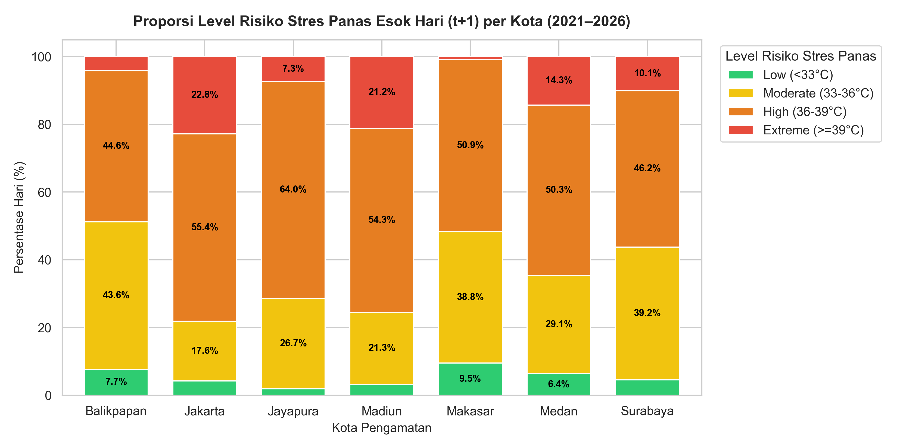
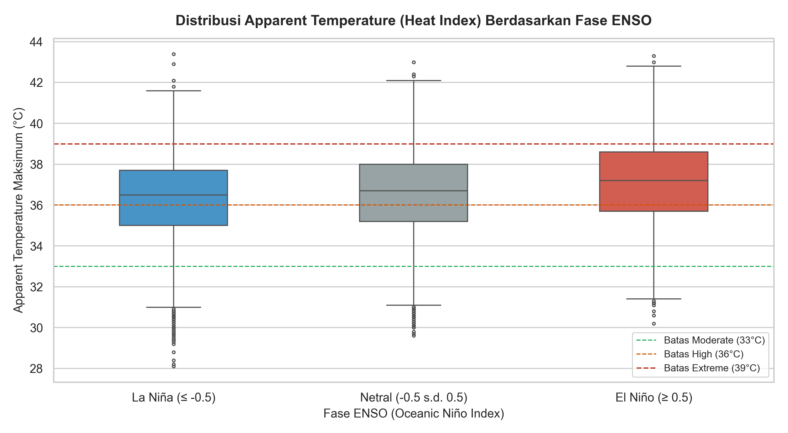
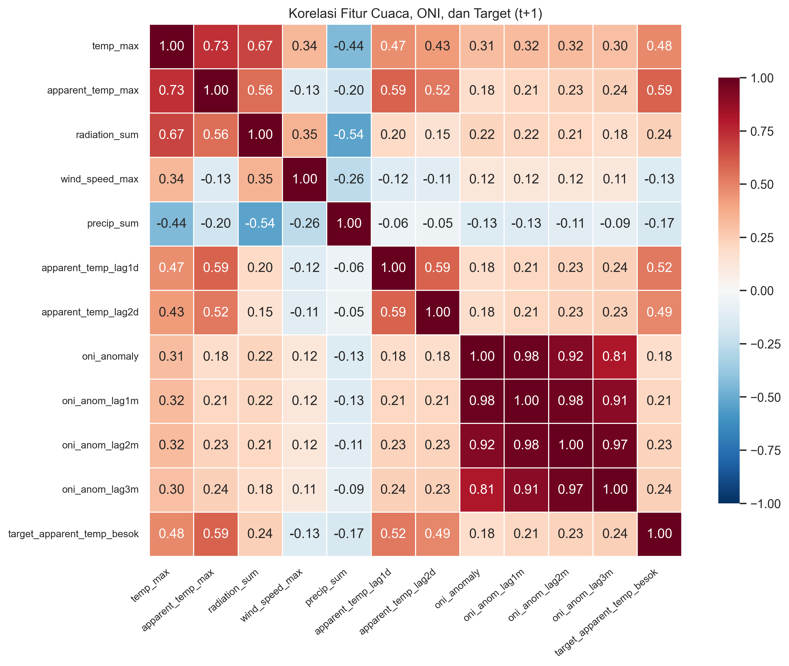

## INFORMASI PROYEK

**Judul Proyek:**  
Prediksi Level Risiko Stres Panas Satu Hari ke Depan bagi Pekerja Lapangan dengan Mempertimbangkan Kondisi El Niño

**Nama Mahasiswa:** 
1. Novandy Triarto Wahyono
2. Alivia Rizka Wardani

**NIM:**
1. 244311053
2. 244311035 

**Program Studi:** Teknologi Rekayasa Perangkat Lunak  
**Mata Kuliah:** Data Science  
**Dosen Pengampu:** Gus Nanang Syaifuddiin, S.Kom., M.Kom.    
**Tahun Akademik:** 2026 / Semester 5  
**Link GitHub Repository:** https://github.com/aliviarizz/Termal-Guard  
**Link Video Pembahasan:** [URL Video (YouTube/Drive)]  
**SDG yang Dipilih:** SDG 13 - Penanganan Perubahan Iklim  
**Target SDG yang Relevan:** Target 13.1: memperkuat ketahanan dan kapasitas adaptasi terhadap bahaya terkait iklim dan bencana alam. Pendukung SDG 8 - keselamatan dan kesehatan kerja 

---

## 0. KERANGKA ML LIFECYCLE (L-M-O-P)

Laporan ini disusun mengikuti **ML Lifecycle** yang terdiri dari empat tahap berulang (iteratif):

| Tahap | Singkatan | Inti Pertanyaan | Bagian Laporan |
|-------|-----------|-----------------|----------------|
| **Learning Problem** | **L** | Apa target, objective, dan datanya? | Bab 2, 3, 4, 5 |
| **Model Design** | **M** | Model family/arsitektur apa, hypothesis space, dan inductive bias/asumsi apa? | Bab 6 (6.x.1 – 6.x.3) |
| **Optimization** | **O** | Bagaimana model dilatih: loss, optimizer, tuning, regularisasi, konvergensi? | Bab 6 (6.x.4 – 6.x.6) |
| **Predict & Evaluate** | **P** | Seberapa baik prediksi model berdasarkan metrik evaluasi? | Bab 7 |

```
   L (Learning Problem) ──► M (Model Design) ──► O (Optimization) ──► P (Predict & Evaluate)
          ▲                                                                   │
          └─────────────── iterasi / perbaikan berdasarkan hasil evaluasi ────┘
```

**Catatan untuk mahasiswa:** Setiap bagian diberi label **[L]**, **[M]**, **[O]**, atau **[P]**. Pastikan Anda dapat menjelaskan keterkaitan antar tahap, misalnya bagaimana hasil **P** mendorong perbaikan pada **L/M/O** (Bab 7.5).

---

## 1. LEARNING OUTCOMES
Pada proyek ini, mahasiswa diharapkan dapat:
1. **[L]** Mengidentifikasi masalah nyata dari **ide sendiri** yang selaras dengan salah satu tujuan **SDGs** ([Agenda 2030 – sdgs.un.org/2030agenda](https://sdgs.un.org/2030agenda)), lalu merumuskan problem statement (target, objective, data) secara jelas
2. **[L]** Melakukan analisis dan eksplorasi data (EDA) secara komprehensif (**OPSIONAL**)
3. **[L]** Melakukan data preparation yang sesuai dengan karakteristik dataset
4. **[M]** Merancang tiga model machine learning dengan justifikasi hypothesis space dan inductive bias (**WAJIB**):
   - Model baseline
   - Model machine learning / advanced
   - Model deep learning (**WAJIB**)
5. **[O]** Mengoptimasi model secara sistematis (loss function, optimizer, hyperparameter tuning, regularisasi)
6. **[P]** Menggunakan metrik evaluasi yang relevan dengan jenis tugas ML dan menganalisis hasilnya
7. Melaporkan hasil eksperimen secara ilmiah dan sistematis
8. Mengunggah seluruh kode proyek ke GitHub (**WAJIB**)
9. Menerapkan prinsip software engineering dalam pengembangan proyek

---

## 2. PROJECT OVERVIEW  **[L]**

### 2.1 Latar Belakang
Pekerja lapangan seperti buruh konstruksi, petani, dan petugas kebersihan bekerja langsung di bawah terik matahari, sehingga berisiko mengalami kelelahan panas (heat exhaustion) dan heat stroke. BMKG menyatakan El Niño 2026 sudah masuk kategori kuat, dan suhu maksimum pada akhir Oktober 2026 tercatat mencapai 38°C atau lebih di Jawa Timur.

Prakiraan cuaca yang tersedia umumnya hanya menampilkan angka suhu, belum menunjukkan tingkat risiko yang bisa dipakai untuk mengatur jam dan beban kerja. Padahal bahaya panas bergantung pada kombinasi suhu dan kelembapan (misalnya melalui heat index), bukan suhu saja. Karena itu, proyek ini memprediksi level risiko stres panas satu hari ke depan sebagai peringatan dini, dan menambahkan indeks El Niño sebagai fitur untuk melihat apakah kondisi iklim global membantu prediksi.

Manfaat proyek: penyedia kerja dan pekerja dapat menyesuaikan jam kerja, waktu istirahat, dan beban kerja sebelum hari yang berbahaya tiba.

**Referensi (berformat APA/IEEE):**
> Amin, M. D. I., Hidayat, J. J., Setyowati, C., Fitri, E. K., Anggraini, A. N., & Werdana, A. P. (2025, November). Implementasi Model LSTM Untuk Peramalan Curah Hujan Di Bekasi Dengan Pemanfaatan Data Cuaca BMKG. Jurnal Teknologi Informasi Digital (JTID), 1(2), 90–99. https://jurnal.ipdig.id/index.php/jtid/article/view/200
> 
> Copernicus Climate Change Service (C3S). (2024). ERA5-Land daily aggregated data from 1950 to present. ECMWF. https://cds.climate.copernicus.eu/datasets/reanalysis-era5-land
> 
> Fadhila, A. N., Santiasih, I., & Disrinama, A. M. (2021). Kenyamanan Termal dan Faktor Individu yang Mempengaruhi Kejadian Heat Strain pada Pekerja. Jurnal Envirotek, 13(1), 60–66. https://envirotek.upnjatim.ac.id/index.php/envirotek/article/view/99
> 
> World Meteorological Organization (WMO). (2024). State of the Global Climate 2023. https://wmo.int/publication-series/state-of-global-climate/state-of-global-climate-2023

> National Aeronautics and Space Administration (NASA). (2024). NASA Prediction of Worldwide Energy Resources (POWER) Data Access Viewer (Version 2.6.25) [Dataset]. NASA Langley Research Center. nasa.gov. https://power.larc.nasa.gov/data-access-viewer/


### 2.2 Keterkaitan dengan SDGs (WAJIB)

Ide proyek **berasal dari mahasiswa** dan harus selaras dengan **salah satu** dari 17 Sustainable Development Goals (daftar dan contoh inspirasi ada di Lampiran A).

| Komponen | Pertanyaan Panduan | Jawaban Anda |
|----------|--------------------|--------------|
| **SDG yang dipilih** | Goal nomor berapa dan apa namanya? | 	SDG 13 – Penanganan Perubahan Iklim |
| **Target SDG** | Target (misal 3.4, 13.1) mana yang paling relevan? | 	Target 13.1: memperkuat ketahanan dan kapasitas adaptasi terhadap bahaya terkait iklim dan bencana alam. Pendukung: SDG 8 target 8.8 (keselamatan dan kesehatan kerja). |
| **Masalah nyata** | Masalah konkret apa yang diangkat? Siapa yang terdampak? | Gelombang panas akibat fenomena El Niño meningkatkan risiko kecelakaan kerja dan *heat stroke* pada pekerja outdoor (konstruksi, pertanian, kebersihan). |
| **Peran ML** | Mengapa ML/DL cocok? Apa keputusan atau proses yang dibantu? | ML dipakai untuk memprediksi level risiko hari berikutnya dari pola cuaca beberapa hari terakhir dan indeks El Niño. Mampu memetakan pola temporal dan non-linear antar variabel atmosferik ((T_{max}), kelembapan, angin, indeks ONI) untuk memberikan rekomendasi level risiko stres panas (t+1). |
| **Indikator kontribusi** | Bagaimana hasil model berkontribusi pada target SDG (langsung/tidak langsung)? | Menyediakan *early warning system* berbasis data presisi bagi manajer K3/lapangan dalam merencanakan jam istirahat dan perlindungan pekerja harian. |
| **Pertimbangan etika** | Risiko bias, privasi, atau dampak salah prediksi? | Prediksi yang terlalu rendah (false negative) dapat membuat pekerja dipaksa bekerja pada kondisi berbahaya, sehingga recall kelas High/Extreme diutamakan |

**Sumber ide:** Pemberitaan El Niño kuat 2026 dan suhu ekstrem di sejumlah wilayah Indonesia, serta belum adanya prakiraan yang menerjemahkan suhu menjadi level risiko kerja.


### 2.3 Ringkasan Alur Lifecycle Proyek
[L] Data cuaca harian ERA5-Land dari tujuh kota dan indeks El Niño dikumpulkan, lalu level risiko hari berikutnya dibentuk dari heat index.    
[M] Tiga model dirancang: Decision Tree sebagai baseline, XGBoost sebagai model advanced, dan LSTM sebagai model deep learning.     
[O] Model dilatih dan dioptimasi dengan validation set berbasis waktu, termasuk tuning hyperparameter dan penanganan kelas tidak seimbang.     
[P] Ketiganya dievaluasi pada test set dengan macro F1 dan recall kelas High/Extreme, lalu satu iterasi perbaikan dilakukan berdasarkan temuan evaluasi.    

---

## 3. BUSINESS UNDERSTANDING / PROBLEM UNDERSTANDING  **[L]**

### 3.1 Problem Statements

1. Prakiraan cuaca konvensional belum mentranslasikan parameter iklim menjadi level risiko stres panas harian (t+1), sehingga sulit dijadikan acuan operasional untuk mengatur jam dan beban kerja pekerja lapangan.
2. Belum tereksplorasinya sejauh mana integrasi fitur iklim harian ERA5 dengan Indeks El Niño (ONI) mampu meningkatkan akurasi peramalan risiko stres panas harian dibanding hanya menggunakan variabel cuaca lokal.
3. Frekuensi kemunculan hari berisiko tinggi yang jauh lebih sedikit dibanding hari biasa menciptakan ketidakseimbangan data (imbalanced data) yang berpotensi memicu bias prediksi model.
4. Tingginya bahaya keselamatan kerja akibat kesalahan prediksi risiko yang terlalu rendah (false negative) menuntut perancangan model (Baseline, Advanced ML, dan LSTM) yang dioptimasi khusus untuk memaksimalkan sensitivitas (Recall) pada kelas risiko bahaya.   

### 3.2 Formulasi Learning Problem (WAJIB)

Rumuskan masalah dalam kerangka *Learning Problem*:

| Komponen | Pertanyaan Panduan | Jawaban Anda |
|----------|--------------------|--------------|
| **Target** | Apa yang diprediksi? Jenis tugas (klasifikasi biner/multikelas, regresi, forecasting, clustering, dll.)? | Level risiko stres panas pada hari berikutnya (t+1) dengan 4 kelas: Low, Moderate, High, Extreme, berdasarkan formulasi Heat Index NOAA. Jenis tugas: Time Series Multiclass Classification |
| **Objective** | Apa yang dioptimalkan/diminimalkan secara matematis (misal: cross-entropy, MSE)? Metrik keberhasilan utama? | Meminimalkan *Categorical Cross-Entropy Loss*. Metrik evaluasi utama: **Recall & Macro F1-Score** (fokus *High Recall* pada kelas *High/Extreme*). |
| **Data** | Sumber, ukuran, jenis, dan asumsi tentang data (i.i.d.? distribusi train vs test?) | Data iklim harian reanalisis ERA5-Land (via Open-Meteo API) dari 7 kota (Madiun, Surabaya, Jakarta, Medan, Balikpapan, Makassar, Jayapura) periode 2021–2026, ditambah indeks El Niño dari NOAA CPC. Perkiraan ≥ 12.000 baris. Data deret waktu tidak i.i.d., sehingga pembagian data dilakukan berdasarkan waktu. Pembagian data dilakukan secara Chronological / Time-Based Split dengan rasio 80% data latih (periode 2021–2025) dan 20% data uji (periode 2026) |

### 3.3 Goals

1. Membangun model klasifikasi yang memprediksi level risiko stres panas satu hari ke depan untuk 7 kota.
2. Membandingkan tiga pendekatan (baseline, advanced, deep learning) dengan metrik macro F1 dan recall kelas High/Extreme, serta pembanding naif (level besok = level hari ini).
3. Mencapai recall kelas High/Extreme minimal 0,80 pada test set (target awal, dapat disesuaikan setelah melihat data).
4. Menguji apakah penambahan indeks El Niño meningkatkan performa, dan melaporkan hasilnya terpisah untuk periode El Niño.
5. Kontribusi SDG: menghasilkan model peringatan dini risiko panas yang mendukung adaptasi terhadap bahaya iklim (target 13.1) dan keselamatan pekerja (target 8.8).

### 3.4 Solution Approach  **[M]**

Mahasiswa **WAJIB** menggunakan minimal **tiga model** dengan komposisi sebagai berikut:
#### **Model 1 – Baseline Model**
Model sederhana sebagai pembanding dasar.
- **Pilihan Model:** Decision Tree Classifier
- **Alasan Pemilihan:** Digunakan sebagai pembanding dasar (*benchmark*) non-linear sederhana berbasis struktur pohon keputusan. Model ini sangat cocok untuk menguji seberapa efektif pemotongan ambang batas (*thresholding*) parameter cuaca sebelum dibagikan ke model *advanced* (XGBoost).
  
#### **Model 2 – Advanced / ML Model**
Model machine learning yang lebih kompleks.
- **Pilihan Model:** XGBoost Classifier
- **Alasan Pemilihan:** Mampu menangani hubungan non-linear antar variabel tabular iklim, tahan terhadap *outliers*, serta memiliki mekanisme *gradient boosting* yang sangat efektif untuk data terstruktur.

#### **Model 3 – Deep Learning Model (WAJIB)**
Model deep learning yang sesuai dengan jenis data.
**Pilihan Implementasi (pilih salah satu sesuai dataset):**  
**A. Time Series:**
- **Pilihan Model:** Long Short-Term Memory (LSTM) Network
- **Jenis Deep Learning:** Recurrent Neural Network (RNN) - Time Series / Sequential Prediction
- **Alasan Pemilihan:** Struktur memori sel LSTM sangat ideal untuk menangkap pola akumulasi temporal, tren sekuensial harian, serta dependensi jangka panjang dari efek El Niño pada parameter cuaca.

**Minimum Requirements untuk Deep Learning:**
- ✅ Model harus training minimal 10 epochs
- ✅ Harus ada plot loss dan accuracy/metric per epoch
- ✅ Harus ada hasil prediksi pada test set
- ✅ Training time dicatat (untuk dokumentasi)

**Tidak Diperbolehkan:**
- ❌ Copy-paste kode tanpa pemahaman
- ❌ Model tidak di-train (hanya define arsitektur)
- ❌ Tidak ada evaluasi pada test set

---

## 4. DATA UNDERSTANDING  **[L]**
### 4.1 Informasi Dataset
**Sumber Dataset:**  
Dataset pada proyek ini merupakan hasil penggabungan (*merging*) dua sumber data iklim dan meteorologi terbuka:
1. **Data Cuaca Harian Historis (ERA5-Land via Open-Meteo Historical Weather API):**  
   - URL: https://open-meteo.com/en/docs/historical-weather-api
   - Cakupan: 7 kota di Indonesia (`Balikpapan`, `Jakarta`, `Jayapura`, `Madiun`, `Makasar`, `Medan`, `Surabaya`) selama periode **1 Januari 2021 – 10 November 2026** (2.140 hari per kota)[cite: 4].
2. **Data Indeks El Niño (NOAA Climate Prediction Center – Oceanic Niño Index / ONI):**  
   - URL: https://www.cpc.ncep.noaa.gov/data/indices/oni.ascii.txt
   - Cakupan: Nilai rata-rata suhu permukaan laut (*Sea Surface Temperature* / SST) dan anomali 3-bulanan berjalan (*3-month running mean*) di wilayah Niño 3.4 ($5^\circ\text{N}–5^\circ\text{S}, 120^\circ–170^\circ\text{W}$).

**Deskripsi Dataset:**
- **Jumlah baris (rows):** 14.980 baris (2.140 hari $\times$ 7 kota)
- **Jumlah kolom (columns/features):** 29 kolom (27 kolom fitur/identitas/lag + 2 variabel numerik kandidat dasar pembentukan kelas risiko stres panas $t+1$)
- **Tipe data:** Time Series Multivariat & Spasial-Tabular (`float64`: 25 kolom, `int64`: 2 kolom, `object`: 2 kolom)
- **Ukuran dataset:** 2,31 MB (2.425.756 bytes di disk; 4,73 MB konsumsi memori RAM)
- **Format file:** CSV (`.csv`) — `dataset_cuaca_elnino_merged.csv`

### 4.2 Deskripsi Fitur
Jelaskan setiap fitur/kolom yang ada dalam dataset.
**Contoh tabel:**
| Nama Fitur | Tipe Data | Deskripsi | Contoh Nilai |
|------------|-----------|-----------|--------------|
| `time` | String (`object`) | Tanggal pencatatan pengamatan cuaca harian (`2021-01-01` s.d. `2026-11-10`, 2.140 hari unik) | `2021-01-01`, `2021-01-02`, `2021-01-03` |
| `kota` | Categorical (`object`) | Nama kota lokasi pengamatan (7 kota unik) | `Balikpapan`, `Jakarta`, `Jayapura` |
| `latitude` | Float (`float64`) | Koordinat garis lintang lokasi pengamatan dalam derajat (`-7.63` s.d. `3.62`, mean `-3.78`) | `-1.23`, `-6.22`, `-2.57` |
| `longitude` | Float (`float64`) | Koordinat garis bujur lokasi pengamatan dalam derajat (`98.69` s.d. `140.70`, mean `115.26`) | `116.85`, `106.86`, `140.70` |
| `elevation` | Float (`float64`) | Ketinggian permukaan lokasi pengamatan dalam meter dpl (`5.00` s.d. `68.00` m, mean `25.71` m) | `16.00`, `12.00`, `45.00` |
| `radiation_sum` | Float (`float64`) | Total radiasi surya gelombang pendek harian dalam $\text{MJ/m}^2$ (`1.04` s.d. `27.31`, mean `18.85`) | `19.27`, `20.05`, `20.53` |
| `temp_max` | Float (`float64`) | Suhu udara maksimum harian pada ketinggian 2 meter dalam $^\circ\text{C}$ (`24.00` s.d. `39.10`, mean `30.72`) | `30.10`, `29.00`, `30.00` |
| `apparent_temp_max` | Float (`float64`) | Suhu terasa (*Heat Index*) maksimum harian pada hari ke-$t$ dalam $^\circ\text{C}$ (`28.10` s.d. `43.40`, mean `36.57`) | `36.70`, `36.00`, `37.10` |
| `wind_speed_max` | Float (`float64`) | Kecepatan angin maksimum harian pada ketinggian 10 meter dalam km/jam (`3.30` s.d. `35.50`, mean `13.09`) | `11.30`, `9.30`, `10.30` |
| `precip_sum` | Float (`float64`) | Total akumulasi curah hujan harian dalam mm (`0.00` s.d. `295.80`, mean `8.37`) | `10.30`, `7.50`, `15.50` |
| `oni_sst_total` | Float (`float64`) | Suhu permukaan laut rata-rata 3-bulanan di wilayah Niño 3.4 dalam $^\circ\text{C}$ (`25.55` s.d. `29.23`, mean `27.15`) | `25.55`, `25.92`, `26.48` |
| `oni_anomaly` | Float (`float64`) | Indeks anomali ONI 3-bulanan bulan berjalan dalam $^\circ\text{C}$ (`-0.99` s.d. `2.46`, mean `0.09`) | `-0.99`, `-0.85`, `-0.74` |
| `oni_anom_lag1m` | Float (`float64`) | Anomali indeks ONI 1 bulan sebelumnya ($m-1$) dalam $^\circ\text{C}$ (`-1.06` s.d. `2.16`, mean `0.03`) | `-1.06`, `-0.99`, `-0.85` |
| `oni_anom_lag2m` | Float (`float64`) | Anomali indeks ONI 2 bulan sebelumnya ($m-2$) dalam $^\circ\text{C}$ (`-1.11` s.d. `1.99`, mean `-0.02`) | `-1.11`, `-1.06`, `-0.99` |
| `oni_anom_lag3m` | Float (`float64`) | Anomali indeks ONI 3 bulan sebelumnya ($m-3$) dalam $^\circ\text{C}$ (`-1.11` s.d. `1.99`, mean `-0.07`) | `-1.00`, `-1.11`, `-1.06` |
| `enso_phase` | Categorical (`float64`) | Fase ENSO berdasarkan ambang ONI $\pm 0,5^\circ\text{C}$ (`-1.0`: La Niña, `0.0`: Netral, `1.0`: El Niño) | `-1.00`, `0.00`, `1.00` |
| `temp_max_lag1d` | Float (`float64`) | Suhu udara maksimum 1 hari sebelumnya ($t-1$) dalam $^\circ\text{C}$ (`24.00` s.d. `39.10`, mean `30.72`) | `30.10`, `29.00`, `30.00` |
| `apparent_temp_lag1d` | Float (`float64`) | Suhu terasa (*Heat Index*) maksimum 1 hari sebelumnya ($t-1$) dalam $^\circ\text{C}$ (`28.10` s.d. `43.40`, mean `36.57`) | `36.70`, `36.00`, `37.10` |
| `precip_lag1d` | Float (`float64`) | Akumulasi curah hujan 1 hari sebelumnya ($t-1$) dalam mm (`0.00` s.d. `295.80`, mean `8.37`) | `10.30`, `7.50`, `15.50` |
| `temp_max_lag2d` | Float (`float64`) | Suhu udara maksimum 2 hari sebelumnya ($t-2$) dalam $^\circ\text{C}$ (`24.00` s.d. `39.10`, mean `30.72`) | `30.10`, `29.00`, `30.00` |
| `apparent_temp_lag2d` | Float (`float64`) | Suhu terasa (*Heat Index*) maksimum 2 hari sebelumnya ($t-2$) dalam $^\circ\text{C}$ (`28.10` s.d. `43.40`, mean `36.57`) | `36.70`, `36.00`, `37.10` |
| `precip_lag2d` | Float (`float64`) | Akumulasi curah hujan 2 hari sebelumnya ($t-2$) dalam mm (`0.00` s.d. `295.80`, mean `8.37`) | `10.30`, `7.50`, `15.50` |
| `temp_max_lag3d` | Float (`float64`) | Suhu udara maksimum 3 hari sebelumnya ($t-3$) dalam $^\circ\text{C}$ (`24.00` s.d. `39.10`, mean `30.72`) | `30.10`, `29.00`, `30.00` |
| `apparent_temp_lag3d` | Float (`float64`) | Suhu terasa (*Heat Index*) maksimum 3 hari sebelumnya ($t-3$) dalam $^\circ\text{C}$ (`28.10` s.d. `43.40`, mean `36.57`) | `36.70`, `36.00`, `37.10` |
| `precip_lag3d` | Float (`float64`) | Akumulasi curah hujan 3 hari sebelumnya ($t-3$) dalam mm (`0.00` s.d. `295.80`, mean `8.38`) | `10.30`, `7.50`, `15.50` |
| `day_of_year` | Integer (`int64`) | Urutan hari dalam kalender tahunan (`1` s.d. `366`, mean `179.34`) | `1`, `2`, `3` |
| `month` | Integer (`int64`) | Bulan kalender (`1` s.d. `12`, mean `6.40`) | `1`, `2`, `3` |
| `target_temp_max_besok` | Float (`float64`) | Suhu udara maksimum 1 hari ke depan ($t+1$) dalam $^\circ\text{C}$ sebagai variabel referensi (`24.00` s.d. `39.10`, mean `30.72`) | `29.00`, `30.00`, `29.70` |
| `target_apparent_temp_besok` | Float (`float64`) | **Dasar Pembentukan Target ($t+1$):** Suhu terasa (*Heat Index*) maksimum 1 hari ke depan (`28.10` s.d. `43.40`, mean `36.57`) yang akan dikategorikan menjadi 4 kelas risiko stres panas (*Low, Moderate, High, Extreme*) | `36.00`, `37.10`, `35.90` |

### 4.3 Kondisi Data

Kondisi dan permasalahan data:

Berdasarkan hasil pemeriksaan kualitas dan distribusi data pada `dataset_cuaca_elnino_merged.csv` (14.980 baris, 29 kolom), kondisi dan permasalahan data dirinci sebagai berikut:

- **Missing Values:**  
  **Ada, sebesar 0,19% dari total dataset (28 baris dari 14.980 baris)**. Seluruh nilai kosong (`NaN`) bukan berasal dari kerusakan data mentah, melainkan konsekuensi alami dari pergeseran deret waktu (*time-series shifting*) pada batas awal dan akhir setiap kota:
  - Fitur historis *lag* 1–3 hari (`temp_max_lag1d` s.d. `precip_lag3d`) memiliki masing-masing **7 `NaN` (0,0467%)** pada tanggal awal `2021-01-01`, **14 `NaN` (0,0935%)** hingga hari ke-2, dan **21 `NaN` (0,1402%)** hingga hari ke-3 di 7 kota.
  - Variabel target esok hari (`target_temp_max_besok` dan `target_apparent_temp_besok`) memiliki **7 `NaN` (0,0467%)** pada tanggal terakhir `2026-11-10` karena observasi tanggal `2026-11-11` belum tersedia.
  - Seluruh variabel meteorologi utama dan indeks ONI memiliki **0% *missing values***.

- **Duplicate Data:**  
  **Tidak ada (0 baris duplikat)**. Pengecekan duplikasi identik di seluruh 29 kolom maupun duplikasi pada kunci komposit `(kota, time)` menghasilkan **0 baris**, sehingga setiap kota memiliki tepat satu rekaman harian yang unik.

- **Outliers:**  
  **Ada**, terdeteksi menggunakan metode *Interquartile Range* ($1,5 \times \text{IQR}$) pada seluruh fitur numerik utama:
  - `precip_sum`: **666 observasi (4,45%)** melampaui batas atas `29,55 mm` (maksimum `295,80 mm`), merepresentasikan kejadian hujan lebat/badai tropis.
  - `oni_anomaly`: **497 observasi (3,32%)** melampaui batas atas `+2,17°C` (maksimum `+2,46°C`), merepresentasikan fase puncak El Niño kuat pada tahun 2026.
  - `wind_speed_max`: **470 observasi (3,14%)** berada di atas `23,25 km/jam` (maksimum `35,50 km/jam`).
  - `radiation_sum`: **375 observasi (2,50%)** berada di bawah batas bawah `8,96 MJ/m²` (minimum `1,04 MJ/m²`) akibat tutupan awan tebal.
  - `temp_max`: **366 observasi (2,44%)** berada di luar rentang `26,05°C – 35,25°C` (maksimum `39,10°C`).
  - `apparent_temp_max`: **162 observasi (1,08%)** berada di luar rentang `31,25°C – 42,05°C` (maksimum `43,40°C`).
  - *Catatan:* Seluruh *outlier* tersebut merupakan fenomena cuaca ekstrem yang valid secara fisik (bukan *error* sensor), sehingga dipertahankan agar model mampu mengenali kondisi bahaya panas ekstrem.

- **Imbalanced Data:**  
  **Ada (ketidakseimbangan kelas moderat–tinggi)**. Hasil simulasi pengkategorian `target_apparent_temp_besok` (14.973 baris valid) menunjukkan:
  - Penggunaan ambang batas *Heat Index* NOAA standar subtropis (`<27°C`, `27–32°C`, `32–41°C`, `≥41°C`) menyebabkan kelas `Low (<27°C)` kosong (**0 sampel / 0,00%**) dan kelas `High` mendominasi hingga **97,08% (14.536 sampel)** karena karakteristik iklim tropis Indonesia yang hangat sepanjang tahun.
  - Dengan kalibrasi ambang batas iklim tropis (`Low: <33°C`, `Moderate: 33–36°C`, `High: 36–39°C`, `Extreme: ≥39°C`), keempat kelas terisi dengan proporsi: **High = 52,23% (7.821 sampel)**, **Moderate = 30,90% (4.627 sampel)**, **Extreme = 11,52% (1.725 sampel)**, dan **Low = 5,34% (800 sampel)** (rasio kelas mayoritas terhadap minoritas sekitar **9,8 : 1**).

- **Noise:**  
  **Sangat minimal (data bersih secara fisis)**. Pemeriksaan konsistensi fisis menunjukkan **0 nilai mustahil** (tidak ada curah hujan, radiasi surya, maupun kecepatan angin bernilai negatif). Hanya ditemukan **4 kejadian (0,03%)** lonjakan suhu maksimum harian $\Delta T > 6^\circ\text{C}$ antar hari berturut-turut, yang merepresentasikan perubahan cuaca mendadak (seperti hujan badai setelah hari terik), bukan *noise* acak.

- **Data Quality Issues:**  
  1. **Perbedaan Resolusi Temporal Antar Sumber:** Data cuaca beresolusi harian, sedangkan indeks ONI NOAA beresolusi rata-rata 3-bulanan berjalan dengan pembaruan terakhir pada musim `ASO 2026` (September 2026). Untuk mengisi data cuaca Oktober–November 2026 tanpa membocorkan informasi masa depan, diterapkan metode *forward-fill* (`ffill`) dari nilai ONI valid terakhir (`+2,46°C`).
  2. **Kontinuitas Kalender Terjaga:** Pengecekan rentang tanggal harian di seluruh 7 kota memastikan **0 tanggal yang hilang/bolong** antara `2021-01-01` hingga `2026-11-10`.
  3. **Penyesuaian Rasio Split Kronologis:** Pemotongan langsung pada batas pergantian tahun `2025` ke `2026` menghasilkan rasio **85,37% : 14,63%** (`12.782` vs `2.191` baris), sehingga pada tahap *Data Splitting* (Bab 5.4) pembagian akan diselaraskan menjadi **Train / Validation / Test** berbasis waktu agar sesuai dengan kebutuhan *tuning* model tanpa kebocoran data.

- **Asumsi Data (i.i.d., distribusi train-test, potensi data leakage):**  
  1. **Non-i.i.d. (*Autocorrelation* Temporal & Spasial):** Data deret waktu harian saling bergantung antar hari berurutan (*serial correlation*) dan terkelompok per lokasi kota, sehingga **tidak memenuhi asumsi *independent and identically distributed* (i.i.d.)**. Pembagian data wajib menggunakan *chronological split* (urutan waktu), bukan *random split*.
  2. **Pergeseran Distribusi (*Covariate Shift*) Train vs Test:** Data periode `2021–2025` didominasi kondisi La Niña dan Netral (rata-rata `oni_anomaly = -0,10`), sedangkan periode `2026` didominasi fase El Niño kuat (rata-rata `oni_anomaly = +1,17`). Kondisi ini menguji ketangguhan generalisasi model saat menghadapi rezim iklim panas ekstrem.
  3. **Potensi *Data Leakage*:** Tiga risiko kebocoran data dimitigasi secara ketat: (a) kebocoran antar-kota saat membuat fitur *lag* dan target $t+1$ (dicegah dengan pengelompokan `.groupby('kota')`), (b) kebocoran statistik masa depan saat *scaling* (dicegah dengan melakukan `fit()` *scaler* hanya pada data *training*), dan (c) jeda rilis indeks ONI bulanan di dunia nyata (dimitigasi dengan menyediakan fitur *lag* `oni_anom_lag1m` hingga `oni_anom_lag3m`).

### 4.4 Exploratory Data Analysis (EDA) - (**OPSIONAL**)

Eksplorasi data dilakukan untuk memahami variasi spasial risiko stres panas antar kota, memvalidasi pengaruh fenomena El Niño terhadap peningkatan suhu terasa (*Heat Index*), serta mengukur kekuatan korelasi fitur historis dan indeks ONI terhadap target prediksi satu hari ke depan ($t+1$).

#### Visualisasi 1: Proporsi Level Risiko Stres Panas Esok Hari ($t+1$) per Kota


**Insight:**  
- **Variasi Risiko Spasial yang Tajam:** Jakarta (**22,81%**) dan Madiun (**21,18%**) mencatat frekuensi hari berisiko **`Extreme (≥39°C)`** tertinggi dibandingkan kota lainnya, diikuti oleh Medan (**14,31%**) dan Surabaya (**10,05%**). Sebaliknya, Makasar hanya mencatat **0,84%** hari `Extreme` dan didominasi oleh kategori `High` (**50,86%**) serta `Moderate` (**38,76%**).
- **Dominasi Kelas `High` & Ketimpangan Kelas:** Di seluruh 7 kota, kategori `High (36–39°C)` merupakan kelas mayoritas dengan proporsi antara **44,65% (Balikpapan)** hingga **64,05% (Jayapura)**, sementara kelas `Low (<33°C)` menjadi minoritas ekstrem (hanya **1,87%** di Jayapura hingga **9,54%** di Makasar). Temuan ini mendasari perlunya penggunaan *One-Hot Encoding* fitur lokasi serta penerapan pembobotan kelas (*class weighting*) pada tahap *Data Preparation* dan *Modeling*.

#### Visualisasi 2: Distribusi *Apparent Temperature* (*Heat Index*) Berdasarkan Fase ENSO


**Insight:**  
- **Pergeseran Distribusi ke Arah Panas Ekstrem saat El Niño:** Terjadi kenaikan bertahap pada nilai rata-rata dan kuartil atas (*Q75*) *apparent temperature* dari fase **La Niña** ($\text{Mean} = 36,24^\circ\text{C}$, $\text{Q75} = 37,70^\circ\text{C}$), **Netral** ($\text{Mean} = 36,53^\circ\text{C}$, $\text{Q75} = 38,00^\circ\text{C}$), hingga mencapai puncaknya pada fase **El Niño** ($\text{Mean} = 37,09^\circ\text{C}$, $\text{Q75} = 38,60^\circ\text{C}$).
- **Lonjakan Risiko `Extreme` Hampir 3 Kali Lipat:** Proporsi hari dengan tingkat risiko **`Extreme (≥39°C)`** meningkat tajam dari **7,10%** pada periode La Niña dan **10,30%** pada periode Netral menjadi **19,67%** pada periode El Niño. Hal ini memvalidasi hipotesis bahwa integrasi indikator ENSO relevan untuk meningkatkan kewaspadaan dini bagi pekerja lapangan.

#### Visualisasi 3: Matriks Korelasi Fitur Cuaca Harian, Indeks ONI (*Lag*), dan Target ($t+1$)


**Insight:**  
- **Autokorelasi Temporal Harian yang Kuat:** Fitur suhu terasa hari ini (`apparent_temp_max`, $r = +0,59$), satu hari lalu (`apparent_temp_lag1d`, $r = +0,52$), dan dua hari lalu (`apparent_temp_lag2d`, $r = +0,49$) memiliki korelasi positif terkuat terhadap `target_apparent_temp_besok`, menegaskan pentingnya memori sekuensial pada arsitektur LSTM maupun fitur *lag* pada model berbasis pohon.
- **Efek Tunda (*Time-Lag*) Indeks El Niño:** Korelasi indeks anomali ONI terhadap suhu terasa esok hari meningkat pada jeda waktu 2 hingga 3 bulan sebelumnya (`oni_anom_lag3m`: $r = +0,24$; `oni_anom_lag2m`: $r = +0,23$; `oni_anom_lag1m`: $r = +0,21$) dibandingkan indeks bulan berjalan (`oni_anomaly`: $r = +0,18$). Secara klimatologis, anomali suhu muka laut di Pasifik membutuhkan jeda waktu sekitar 2–3 bulan untuk memengaruhi sirkulasi monsun dan suhu permukaan di Indonesia, sekaligus menguntungkan pemodelan operasional karena fitur *lag* 1–3 bulan sudah tersedia tanpa jeda rilis data.
- **Korelasi Negatif Presipitasi & Angin:** Curah hujan (`precip_sum`, $r = -0,17$) dan kecepatan angin maksimum (`wind_speed_max`, $r = -0,13$) berkorelasi negatif terhadap suhu terasa esok hari karena efek pendinginan evaporatif dan tutupan awan hujan.

---

## 5. DATA PREPARATION  **[L]**

## 5. DATA PREPARATION  **[L]**

Pipeline data preparation dijalankan di [`notebooks/02_data_preparation.ipynb`](notebooks/02_data_preparation.ipynb). Seluruh preprocessing mengikuti urutan waktu; statistik transformasi hanya dipelajari dari data train.

### 5.1 Data Cleaning

- **Missing values:** Dataset awal berisi 14.980 baris; 28 baris memiliki setidaknya satu `NaN`. Nilai kosong berasal dari fitur lag pada tiga hari pertama dan target $t+1$ pada hari terakhir di setiap kota.
- **Strategi:** Menghapus baris yang mengandung `NaN` (`dropna`) tanpa imputasi, karena data tersebut tidak memiliki seluruh konteks historis atau target yang diperlukan. Hasilnya **14.952 baris bersih**, tepat **2.136 baris per kota**, dengan **0 `NaN`**.
- **Duplikat:** Pemeriksaan seluruh baris dan kunci `(kota, time)` menemukan **0 duplikat**.
- **Outlier:** Tidak dihapus. Deteksi 1,5 × IQR menemukan outlier pada `precip_sum` (666), `oni_anomaly` (497), `wind_speed_max` (470), `radiation_sum` (375), `temp_max` (366), dan `apparent_temp_max` (162); kejadian tersebut dipertahankan karena valid secara meteorologis.
- Kolom `time` dikonversi ke `datetime` dan baris diurutkan menurut `kota` lalu `time` sebelum pemisahan.

### 5.2 Feature Engineering

- Target `heat_risk_besok` dibentuk dari `target_apparent_temp_besok` dengan `pd.cut(..., right=False)` dan batas `[-∞, 33, 36, 39, ∞]`: **0 Low**, **1 Moderate**, **2 High**, **3 Extreme**. Pada data bersih, jumlah kelas berturut-turut adalah **796**, **4.618**, **7.813**, dan **1.725** sampel.
- Fitur baru: `sin_doy` dan `cos_doy` (periode 365,25 hari), `temp_range_or_heat_gap` (`apparent_temp_max - temp_max`), serta `apparent_temp_diff_1d` (`apparent_temp_max - apparent_temp_lag1d`).
- Untuk mencegah leakage, fitur input tidak memuat `target_temp_max_besok`, `target_apparent_temp_besok`, `oni_anomaly`, `oni_sst_total`, maupun `enso_phase` (yang diturunkan dari ONI bulan berjalan dengan jeda publikasi NOAA). `time` hanya menjadi indeks kronologis; `day_of_year` mentah digantikan oleh fitur siklikal. Fitur historis ONI (`oni_anom_lag1m`–`oni_anom_lag3m`) dipertahankan.
- Matriks sebelum encoding terdiri dari **26 kolom**, setelah `kota` di-one-hot menjadi **32 fitur**.

### 5.3 Data Transformation

- **Decision Tree dan XGBoost:** fitur `kota` di-one-hot encode menjadi tujuh kolom identik pada seluruh split. Sebanyak 25 fitur numerik kontinyu distandardisasi dengan `StandardScaler`; fitur biner one-hot tidak di-scale. `fit()` hanya dilakukan pada `X_train`, lalu scaler yang sama mentransformasi validation dan test.
- **LSTM:** sliding window tujuh hari dibentuk terpisah untuk masing-masing kota dan split. Label sequence adalah target `t+1` pada baris terakhir window; jendela tidak menyeberangi batas kota maupun split. Enam baris awal per kota pada setiap split tidak menjadi sequence.
- Bentuk data tabular: `X_train` **10.206 × 32**, `X_val` **2.555 × 32**, `X_test` **2.191 × 32**.
- Bentuk sequence: `X_train_seq` **(10.164, 7, 32)**, `X_val_seq` **(2.513, 7, 32)**, `X_test_seq` **(2.149, 7, 32)**; array label masing-masing berukuran **10.164**, **2.513**, dan **2.149**.

### 5.4 Data Splitting

- Split ditentukan sebelum encoding/scaling dan tidak menggunakan shuffle:

| Split | Rentang tanggal pada data bersih | Sampel | Persentase | Low | Moderate | High | Extreme |
|---|---|---:|---:|---:|---:|---:|---:|
| Train | 2021-01-04 – 2024-12-31 | 10.206 | 68,26% | 5,73% | 31,62% | 51,23% | 11,41% |
| Validation | 2025-01-01 – 2025-12-31 | 2.555 | 17,09% | 4,58% | 29,35% | 55,77% | 10,29% |
| Test | 2026-01-01 – 2026-11-09 | 2.191 | 14,65% | 4,29% | 29,26% | 52,90% | 13,56% |

- Test berakhir pada 9 November 2026 karena target hari berikutnya untuk 10 November tidak tersedia. Test disimpan untuk evaluasi akhir; tuning hanya menggunakan validation. Rentang train pada data bersih dimulai 4 Januari karena tiga hari pertama per kota diperlukan sebagai konteks lag.

### 5.5 Data Balancing

- Ketimpangan kelas ditangani menggunakan `compute_class_weight(class_weight="balanced")` dan `compute_sample_weight(class_weight="balanced")`, yang dihitung **hanya dari `y_train`**. Bobot kelas: **Low 4,3615**, **Moderate 0,7907**, **High 0,4880**, **Extreme 2,1901**.
- SMOTE tidak digunakan agar urutan waktu dan keterkaitan meteorologis tidak berubah akibat sampel sintetis; validation dan test tidak di-resample atau digunakan untuk menghitung bobot.

### 5.6 Ringkasan Data Preparation

| Tahap | Apa | Mengapa | Bagaimana |
|---|---|---|---|
| Cleaning | Menghapus NaN dan memeriksa duplikat; mempertahankan outlier valid. | Menyediakan observasi lengkap tanpa mengubah kejadian cuaca ekstrem. | `dropna()` menghasilkan 14.952 baris (2.136 per kota), 0 NaN, 0 duplikat. |
| Feature engineering/selection | Membuat target 4 kelas, fitur musim siklikal, heat gap, dan perubahan suhu; membuang kolom leakage. | Menyediakan prediktor temporal yang tersedia secara operasional tanpa target masa depan atau ONI/ENSO bulan berjalan. | Ambang tropis 33/36/39°C; fitur lag ONI dipertahankan; 32 fitur sesudah one-hot. |
| Splitting | Memisahkan train, validation, dan test secara kronologis. | Menghormati sifat non-i.i.d. dan menjaga test untuk evaluasi akhir. | 10.206 train (68,26%), 2.555 validation (17,09%), 2.191 test (14,65%). |
| Transformation | One-hot kota, standardisasi numerik, dan window sequence tujuh hari. | Menghasilkan input tabular dan sekuensial dengan skala konsisten serta tanpa leakage antarkota/split. | Scaler fit hanya pada train; LSTM: (10.164, 7, 32), (2.513, 7, 32), (2.149, 7, 32). |
| Balancing & artefak | Menghitung bobot kelas train dan menyimpan dataset siap latih. | Mengatasi imbalance tanpa mengacak urutan waktu serta mendukung pemakaian ulang hasil preprocessing. | CSV `X/y` tiap split, `lstm_sequences.npz`, `scaler.joblib`, `class_weights.json` di `data/processed/`. |

---

## 6. MODELING  **[M + O]**

> Setiap model (6.1, 6.2, 6.3) dijelaskan dalam dua fase: **Model Design [M]** (sub-bagian .1–.3) dan **Optimization [O]** (sub-bagian .4–.6).

### 6.1 Model 1 — Baseline: Decision Tree Classifier

#### 6.1.1 Deskripsi Model  **[M]**

**Nama Model:** Decision Tree Classifier (CART — Classification and Regression Trees)

**Teori Singkat:**  
Decision Tree adalah model pohon hierarki yang membagi ruang fitur secara rekursif menggunakan aturan *if-else* berbasis threshold (nilai ambang batas) pada satu fitur di setiap node. Algoritma CART memilih split yang meminimalkan kriteria impurity (Gini impurity atau Entropy) di setiap langkah secara *greedy* (lokal-optimal). Prediksi kelas dilakukan berdasarkan kelas mayoritas pada daun (leaf node) yang dicapai oleh data.

**Alasan Pemilihan:**  
Decision Tree dipilih sebagai model baseline karena:
1. **Data tabular iklim multivariat** — dataset terdiri dari 32 fitur cuaca numerik dan kategorikal (kota) yang diproses secara tabular, bukan sekuensial. Decision Tree sangat efisien untuk data tabular.
2. **Hubungan non-linear berbasis ambang batas** — risiko stres panas secara fisiologis terikat pada nilai *threshold* (mis. suhu >38°C → High, >40°C → Extreme). Decision Tree secara alami menangkap struktur ini.
3. **Interpretabilitas** — sebagai baseline, Decision Tree mudah diinterpretasikan untuk memvalidasi apakah model menangkap pengetahuan domain.
4. **Pembanding awal sebelum boosting** — perlu model sederhana untuk mengukur besarnya peningkatan yang diberikan oleh XGBoost (Model 2).

#### 6.1.2 Hypothesis Space & Inductive Bias  **[M]**

- **Model family / arsitektur:** Pohon keputusan tunggal (*single decision tree*), model non-parametrik berbasis partisi hierarki ruang fitur.
- **Hypothesis space:** Himpunan semua fungsi *piecewise-constant axis-aligned* pada ruang fitur ℝ³². Setiap fungsi didefinisikan oleh sekumpulan aturan threshold berbentuk `fᵢ ≤ θ` yang membentuk hiperplane sejajar sumbu koordinat. Kapasitas hipothesis space bertumbuh eksponensial dengan kedalaman pohon.
- **Inductive bias / asumsi:**
  - *Greedy split*: pemilihan split dilakukan secara lokal-optimal di setiap node (bukan global-optimal), sehingga pohon tidak dijamin menemukan partisi terbaik secara global.
  - *Axis-aligned boundaries*: batas keputusan harus sejajar sumbu fitur; tidak dapat menangkap hubungan diagonal atau interaksi fitur yang halus tanpa membutuhkan banyak node.
  - *Piecewise-constant*: prediksi dalam satu leaf bersifat konstan (kelas mayoritas), sehingga tidak dapat memperkirakan gradasi probabilitas dalam leaf yang heterogen.
  - *Hierarki ambang batas*: asumsi bahwa data dapat dipartisi bersih oleh aturan threshold sekuensial — cocok untuk hubungan cuaca-risiko yang bersifat threshold (mis. WBGT > 32°C → Extreme).
- **Implikasi terhadap dataset cuaca multivariat non-i.i.d.:**
  - **Pro:** Hubungan non-linear berbasis ambang batas suhu/hujan/angin memang sesuai dengan inductive bias Decision Tree.
  - **Kontra:** Tanpa batasan `max_depth`, Decision Tree dengan 1 pohon cenderung *overfitting parah* pada time-series meteorologi karena setiap kombinasi nilai lag-fitur membentuk leaf tersendiri. Hal ini terbukti pada hasil (Train Macro F1 = 1.0000 vs Val Macro F1 = 0.3679).
  - Data time-series bersifat non-i.i.d. (ada autokorelasi temporal) yang tidak secara eksplisit dimodelkan oleh Decision Tree — model tidak tahu bahwa sampel hari-t berkorelasi dengan hari t-1.

#### 6.1.3 Implementasi (Ringkas)  **[M]**

Implementasi lengkap tersedia di `notebooks/03_model_design_baseline_ml.ipynb`.

```python
from sklearn.tree import DecisionTreeClassifier

# Class weights dari class_weights.json (map ke integer)
# {0: 4.3615, 1: 0.7907, 2: 0.4880, 3: 2.1901}

baseline_model = DecisionTreeClassifier(
    criterion="gini",
    max_depth=None,   # Tanpa batas → pohon tumbuh penuh
    random_state=42,
    class_weight=class_weights  # Menangani imbalanced data
)
baseline_model.fit(X_train, y_train)
y_pred_val = baseline_model.predict(X_val)
```

#### 6.1.4 Optimization: Objective, Hyperparameter & Regularisasi  **[O]**

**Objective/loss yang dioptimalkan:** Gini Impurity minimization di setiap node split.  
Gini impurity: $G(t) = 1 - \sum_{k=0}^{K-1} p(k|t)^2$

**Parameter yang digunakan (sesuai `03_model_design_baseline_ml.ipynb`):**
```
- criterion   : "gini"      # Gini impurity sebagai split criterion
- max_depth   : None        # Pohon tumbuh penuh tanpa batas kedalaman
- random_state: 42          # Reproducibility
- class_weight: {0: 4.3615, 1: 0.7907, 2: 0.4880, 3: 2.1901}
                            # Bobot inversely proportional terhadap frekuensi kelas
                            # untuk menangani imbalanced data (rasio ~9.8:1)
```

**Catatan:** Pada Minggu 4, parameter regularisasi seperti `max_depth`, `min_samples_leaf`,  
dan `min_samples_split` akan dituning untuk mengurangi overfitting.

#### 6.1.5 Hasil Awal  **[O → P]**

Hasil evaluasi pada **Validation Set 2025** (`X_val.csv`, `y_val.csv`) dari `03_model_design_baseline_ml.ipynb`:

| Metrik | Nilai |
|--------|-------|
| **Validation Accuracy** | **0.5033 (50.33%)** |
| **Validation Macro F1** | **0.3679** |
| Validation Weighted F1 | 0.5021 |
| Training Macro F1 | 1.0000 (100.00%) |
| Train-Val Gap | 0.6321 (**Overfitting Parah**) |
| Waktu Training | 0.1780 detik |

**Classification Report (Validation Set 2025):**
```
                    precision    recall  f1-score   support

     Class 0 (Low)       0.17      0.15      0.16       117
Class 1 (Moderate)       0.42      0.42      0.42       750
    Class 2 (High)       0.61      0.62      0.62      1425
 Class 3 (Extreme)       0.28      0.29      0.28       263

          accuracy                           0.50      2555
         macro avg       0.37      0.37      0.37      2555
      weighted avg       0.50      0.50      0.50      2555
```

**Analisis:** Model mengalami **overfitting parah** (gap 0.63). Train Macro F1 = 1.0 menunjukkan  
pohon menghafal seluruh data training, namun hanya generalisasi 36.79% pada validation set.  
Recall kelas Extreme (0.29) sangat rendah — 71% kondisi ekstrem tidak terdeteksi, berbahaya  
untuk keselamatan pekerja lapangan.

---

### 6.2 Model 2 — Advanced ML: XGBoost Classifier

#### 6.2.1 Deskripsi Model  **[M]**

**Nama Model:** XGBoost Classifier — eXtreme Gradient Boosting (Chen & Guestrin, 2016)

**Teori Singkat:**  
XGBoost adalah implementasi *Gradient Boosted Decision Trees* (GBDT) yang sangat dioptimalkan.  
Model dibangun secara **sekuensial aditif**: setiap pohon baru ($T_m$) dilatih untuk memperbaiki  
*residual error* pohon-pohon sebelumnya, dengan mengoptimalkan fungsi objektif menggunakan  
**aproksimasi Taylor orde kedua** (memanfaatkan gradien dan Hessian).

Fungsi prediksi ensemble: $\hat{y}_i = \sum_{m=1}^{M} \eta \cdot T_m(\mathbf{x}_i)$

Fungsi objektif per iterasi (dengan regularisasi L1/L2):  
$\mathcal{L}^{(m)} = \sum_{i} l(y_i, \hat{y}_i^{(m-1)} + T_m(\mathbf{x}_i)) + \Omega(T_m)$  
$\Omega(T) = \gamma J + \frac{1}{2}\lambda \sum_{j=1}^{J} w_j^2 + \alpha \sum_{j=1}^{J} |w_j|$

di mana $\gamma$ = penalti jumlah leaf, $\lambda$ = L2 regularisasi bobot leaf, $\alpha$ = L1.

**Alasan Pemilihan:**
1. **Hubungan non-linear kompleks antar variabel atmosferik & lag ONI** — interaksi antara `apparent_temp_max`, `oni_anom_lag1m`–`lag3m`, `precip_sum`, dan `wind_speed_max` bersifat non-linear dan tidak dapat ditangkap model sederhana.
2. **Tahan terhadap outlier hujan/suhu ekstrem** — GBDT berbasis tree tidak sensitif terhadap skala atau outlier, cocok untuk data cuaca yang memiliki distribusi non-normal.
3. **Mendukung `sample_weight`** — XGBClassifier multikelas mendukung bobot per sampel untuk menangani *imbalanced data* (kelas Low:Extreme = 9.8:1 dalam dataset ini).
4. **Regularisasi built-in** — L1/L2 pada bobot leaf dan pruning berbasis gain (`gamma`) mencegah overfitting yang parah terjadi pada Decision Tree.

**Keunggulan:**
- Performa tinggi pada data tabular (sering juara di kompetisi Kaggle)
- Regularisasi L1/L2 built-in mencegah overfitting
- Mendukung `sample_weight` dan `eval_metric` untuk multikelas
- Feature importance tersedia (weight/gain/cover) untuk interpretasi
- Efisien secara komputasi (parallel tree construction, cache-aware)

**Kelemahan:**
- Tidak secara eksplisit memodelkan ketergantungan temporal (time-series bukan *native use case*)
- Hyperparameter yang banyak membutuhkan tuning yang lebih kompleks
- Training lebih lama dibanding Decision Tree tunggal (~7.2s vs ~0.18s)
- Kurang interpretable dibanding pohon tunggal (black-box ensemble)

#### 6.2.2 Hypothesis Space & Inductive Bias  **[M]**

- **Model family / arsitektur:** Ensemble aditif dari $M$ pohon keputusan (*Gradient Boosted Decision Trees*), model non-parametrik sekuensial.
- **Hypothesis space:** Himpunan semua kombinasi linear dari $M$ fungsi *piecewise-constant axis-aligned* (pohon keputusan) pada ruang fitur ℝ³². Kapasitas jauh lebih besar dari pohon tunggal — dapat merepresentasikan batas keputusan yang sangat kompleks dan interaksi fitur otomatis melalui komposisi sequential.
- **Inductive bias / asumsi:**
  - *Boosting sekuensial*: setiap pohon memperbaiki error pohon sebelumnya — cocok untuk data di mana error bersifat terstruktur (misalnya, hari-hari El Niño yang salah diprediksi oleh pohon awal).
  - *Regularisasi kompleksitas daun*: penalti $\gamma$ dan $\lambda$ mendorong model memilih pohon yang lebih sederhana (lebih sedikit leaf) secara eksplisit — mengurangi overfitting.
  - *Subsampling stokastik*: `subsample=0.8` dan `colsample_bytree=0.8` memperkenalkan randomisasi seperti Random Forest — mengurangi korelasi antar pohon dan meningkatkan generalisasi.
  - *Threshold berbasis fitur*: warisan dari decision tree — masih mengandalkan pemisahan axis-aligned, cocok untuk data dengan ambang batas cuaca yang mendefinisikan level risiko.
- **Perbandingan dengan Decision Tree baseline:**
  - Decision Tree membangun 1 pohon besar yang hafal training data (overfitting).
  - XGBoost membangun 200 pohon kecil (`max_depth=6`) yang masing-masing mempelajari *residual* — ensemble lebih robust dan generalisasi lebih baik.
  - XGBoost dapat menangkap **interaksi fitur yang lebih halus** (mis. `apparent_temp_max × oni_anom_lag2m`) melalui komposisi sequential trees.
  - Regularisasi eksplisit di XGBoost mengontrol bias-variance trade-off yang tidak ada di Decision Tree dengan `max_depth=None`.

#### 6.2.3 Implementasi (Ringkas)  **[M]**

Implementasi lengkap tersedia di `notebooks/03_model_design_advanced_ml.ipynb`.

```python
import numpy as np
from xgboost import XGBClassifier

# Bangun sample_weight dari class_weights.json
# {0: 4.3615, 1: 0.7907, 2: 0.4880, 3: 2.1901}
sample_weight_train = np.array([class_weights[label] for label in y_train])

# Inisialisasi XGBoost Classifier
xgb_model = XGBClassifier(
    objective="multi:softprob",   # Multikelas, output probabilitas
    num_class=4,                   # 4 kelas: Low, Moderate, High, Extreme
    eval_metric="mlogloss",        # Multi-class log loss
    n_estimators=200,              # 200 boosting rounds
    max_depth=6,                   # Kedalaman maksimal per pohon
    learning_rate=0.1,             # Step size shrinkage (eta)
    subsample=0.8,                 # Subsampling baris per iterasi
    colsample_bytree=0.8,          # Subsampling fitur per pohon
    random_state=42,               # Reproducibility
    n_jobs=-1,                     # Gunakan semua CPU cores
)

# Training dengan sample_weight (imbalanced data handling)
xgb_model.fit(X_train, y_train, sample_weight=sample_weight_train)
y_pred_val = xgb_model.predict(X_val)
```

#### 6.2.4 Optimization: Hyperparameter Tuning  **[O]**

**Parameter awal yang digunakan (konfigurasi LKM 12):**
```
- objective         : "multi:softprob"   # Klasifikasi multikelas, output probabilitas per kelas
- num_class         : 4                  # 4 level risiko
- eval_metric       : "mlogloss"         # Monitoring log-loss multikelas
- n_estimators      : 200                # Jumlah pohon boosting
- max_depth         : 6                  # Kedalaman maksimal (regularisasi kompleksitas)
- learning_rate     : 0.1               # Step size shrinkage (eta)
- subsample         : 0.8               # Fraksi sampel per iterasi (stochastic gradient)
- colsample_bytree  : 0.8               # Fraksi fitur per pohon (feature subsampling)
- random_state      : 42                # Reproducibility
- n_jobs            : -1                # Parallelisasi CPU
```

> **Catatan:** Hyperparameter tuning lanjutan (Grid Search / Optuna) akan dilengkapi pada **Minggu 4**  
> (sesuai timeline LKM). Parameter yang akan dituning meliputi: `max_depth`, `n_estimators`,  
> `learning_rate`, `reg_alpha` (L1), `reg_lambda` (L2), `min_child_weight`, `gamma`,  
> dan penggunaan *early stopping* dengan validation set.

#### 6.2.5 Kontrol Overfitting  **[O]**

Mekanisme regularisasi/overfitting control pada XGBoost yang digunakan:

| Mekanisme | Parameter | Nilai | Efek |
|-----------|-----------|-------|------|
| **Kedalaman pohon** | `max_depth` | 6 | Membatasi kompleksitas per pohon (vs Decision Tree: tak terbatas) |
| **Subsampling baris** | `subsample` | 0.8 | 20% sampel tidak digunakan per iterasi → mencegah memorization |
| **Subsampling fitur** | `colsample_bytree` | 0.8 | 20% fitur tidak digunakan per pohon → diversifikasi |
| **Learning rate** | `learning_rate` | 0.1 | Shrinkage → kontribusi setiap pohon dikecilkan |

> **Catatan:** Pada Minggu 4, akan ditambahkan: `reg_alpha` (L1), `reg_lambda` (L2),  
> `gamma` (pruning threshold), `min_child_weight`, dan *early stopping* pada validation loss.

#### 6.2.6 Hasil Awal  **[O → P]**

Hasil evaluasi pada **Validation Set 2025** dari `notebooks/03_model_design_advanced_ml.ipynb`:

| Metrik | Decision Tree (Baseline) | XGBoost (Advanced) | Delta |
|--------|--------------------------|---------------------|-------|
| **Val Accuracy** | 0.5033 (50.33%) | **0.5476 (54.76%)** | +4.43% |
| **Val Macro F1** | 0.3679 | **0.4479** | **+0.0800** |
| Val Weighted F1 | 0.5021 | 0.5527 | +0.0506 |
| **Recall High (2)** | 0.6200 | **0.6070** | −0.0130 |
| **Recall Extreme (3)** | 0.2900 | **0.5361** | **+0.2461** |
| Train Macro F1 | 1.0000 | 0.9093 | — |
| Train-Val Gap | 0.6321 (Overfitting Parah) | 0.4614 (Overfitting Parah) | — |
| **Waktu Training** | 0.1780 s | 7.1915 s | +7.0s |

**Classification Report XGBoost (Validation Set 2025):**
```
                    precision    recall  f1-score   support

     Class 0 (Low)       0.26      0.23      0.24       117
Class 1 (Moderate)       0.48      0.49      0.48       750
    Class 2 (High)       0.67      0.61      0.64      1425
 Class 3 (Extreme)       0.36      0.54      0.43       263

          accuracy                           0.55      2555
         macro avg       0.44      0.47      0.45      2555
      weighted avg       0.56      0.55      0.55      2555
```

**Analisis Perbandingan:**
- **Macro F1 meningkat signifikan** (+0.08): XGBoost (0.4479) lebih seimbang dibanding Decision Tree (0.3679) dalam memprediksi semua kelas.
- **Recall Extreme naik drastis** (+24.61pp): dari 0.29 → 0.54. Perbaikan kritis untuk keselamatan pekerja — lebih banyak kondisi ekstrem terdeteksi.
- **Overfitting masih ada** tetapi berkurang: gap 0.4614 (XGBoost) vs 0.6321 (Decision Tree). Regularisasi XGBoost mulai efektif namun hyperparameter tuning lanjutan diperlukan.
- **Trade-off waktu training**: XGBoost 40× lebih lambat (7.19s vs 0.18s) namun hasilnya lebih baik secara signifikan.

**Top 5 Fitur Paling Penting (berdasarkan feature importance):**
1. `apparent_temp_max` (0.1485) — suhu terasa maksimum, fitur paling dominan
2. `apparent_temp_lag1d` (0.0522) — lag suhu terasa 1 hari
3. `kota_Jayapura` (0.0499) — lokasi geografis
4. `temp_max` (0.0438) — suhu udara maksimum
5. `kota_Makasar` (0.0424) — lokasi geografis

Fitur El Niño: `oni_anom_lag2m` (0.0316, rank 7) dan `oni_anom_lag3m` (0.0290, rank 10) masuk Top 15, membuktikan relevansi kondisi ENSO dalam prediksi risiko stres panas..

---

### 6.3 Model 3 — Deep Learning Model (WAJIB)

#### 6.3.1 Deskripsi Model  **[M]**

**Nama Model:** [Nama arsitektur, misal: CNN / LSTM / MLP]

** (Centang) Jenis Deep Learning: **
- [ ] Multilayer Perceptron (MLP) - untuk tabular
- [ ] Convolutional Neural Network (CNN) - untuk image
- [ ] Recurrent Neural Network (LSTM/GRU) - untuk sequential/text
- [ ] Transfer Learning - untuk image
- [ ] Transformer-based - untuk NLP
- [ ] Autoencoder - untuk unsupervised
- [ ] Neural Collaborative Filtering - untuk recommender

**Alasan Pemilihan:**  
[Mengapa arsitektur ini cocok untuk dataset Anda?]

#### 6.3.2 Arsitektur Model, Hypothesis Space & Inductive Bias  **[M]**

**Inductive bias arsitektur:** [misal: CNN → lokalitas & translation invariance; LSTM → ketergantungan sekuensial; MLP → tanpa asumsi struktur]  
**Hypothesis space:** [kapasitas model: jumlah layer, unit, parameter]

**Deskripsi Layer:**

[Jelaskan arsitektur secara detail atau buat tabel]

**Contoh:**
```
1. Input Layer: shape (224, 224, 3)
2. Conv2D: 32 filters, kernel (3,3), activation='relu'
3. MaxPooling2D: pool size (2,2)
4. Conv2D: 64 filters, kernel (3,3), activation='relu'
5. MaxPooling2D: pool size (2,2)
6. Flatten
7. Dense: 128 units, activation='relu'
8. Dropout: 0.5
9. Dense: 10 units, activation='softmax'

Total parameters: [jumlah]
Trainable parameters: [jumlah]
```

#### 6.3.3 Input & Preprocessing Khusus  **[M]**

**Input shape:** [Sebutkan dimensi input]  
**Preprocessing khusus untuk DL:**
- [Sebutkan preprocessing khusus seperti normalisasi, augmentasi, dll.]

#### 6.3.4 Optimization: Konfigurasi Training  **[O]**

**Training Configuration:**
```
- Optimizer: Adam / SGD / RMSprop
- Learning rate: [nilai]
- Loss function: [categorical_crossentropy / mse / binary_crossentropy / etc.]
- Metrics: [accuracy / mae / etc.]
- Batch size: [nilai]
- Epochs: [nilai]
- Validation split: [nilai] atau menggunakan validation set terpisah
- Callbacks: [EarlyStopping, ModelCheckpoint, ReduceLROnPlateau, etc.]
- Regularisasi: [Dropout / L2 / BatchNorm / augmentasi]
```

**Eksperimen optimasi (minimal 2 konfigurasi dibandingkan):**

| Eksperimen | Learning Rate | Batch Size | Regularisasi | Val Loss | Val Metric |
|------------|---------------|------------|--------------|----------|------------|
| Exp-1 | [ ] | [ ] | [ ] | [ ] | [ ] |
| Exp-2 | [ ] | [ ] | [ ] | [ ] | [ ] |

#### 6.3.5 Implementasi (Ringkas)  **[M + O]**

**Framework:** TensorFlow/Keras / PyTorch
```python
# Contoh kode TensorFlow/Keras
import tensorflow as tf
from tensorflow import keras

model_dl = keras.Sequential([
    keras.layers.Dense(128, activation='relu', input_shape=(input_dim,)),
    keras.layers.Dropout(0.3),
    keras.layers.Dense(64, activation='relu'),
    keras.layers.Dropout(0.3),
    keras.layers.Dense(num_classes, activation='softmax')
])

model_dl.compile(
    optimizer='adam',
    loss='categorical_crossentropy',
    metrics=['accuracy']
)

history = model_dl.fit(
    X_train, y_train,
    validation_split=0.2,
    epochs=50,
    batch_size=32,
    callbacks=[early_stopping]
)
```

#### 6.3.6 Training Process & Diagnosis Optimasi  **[O]**

**Training Time:**  
[Sebutkan waktu training total, misal: 15 menit]

**Computational Resource:**  
[CPU / GPU, platform: Local / Google Colab / Kaggle]

**Training History Visualization:**

[Insert plot loss dan accuracy/metric per epoch]

**Contoh visualisasi yang WAJIB:**
1. **Training & Validation Loss** per epoch
2. **Training & Validation Accuracy/Metric** per epoch

**Analisis Training:**
- Apakah model mengalami overfitting? [Ya/Tidak, jelaskan]
- Apakah model sudah converge? [Ya/Tidak, jelaskan]
- Apakah perlu lebih banyak epoch? [Ya/Tidak, jelaskan]
- Apakah learning rate sesuai (loss stabil/osilasi/lambat)? [Jelaskan]

#### 6.3.7 Model Summary
```
[Paste model.summary() output atau rangkuman arsitektur]
```

---

## 7. EVALUATION  **[P]**

### 7.1 Metrik Evaluasi

**Pilih metrik yang sesuai dengan jenis tugas:**

#### **Untuk Klasifikasi:**
- **Accuracy**: Proporsi prediksi yang benar
- **Precision**: TP / (TP + FP)
- **Recall**: TP / (TP + FN)
- **F1-Score**: Harmonic mean dari precision dan recall
- **ROC-AUC**: Area under ROC curve
- **Confusion Matrix**: Visualisasi prediksi

#### **Untuk Regresi:**
- **MSE (Mean Squared Error)**: Rata-rata kuadrat error
- **RMSE (Root Mean Squared Error)**: Akar dari MSE
- **MAE (Mean Absolute Error)**: Rata-rata absolute error
- **R² Score**: Koefisien determinasi
- **MAPE (Mean Absolute Percentage Error)**: Error dalam persentase

#### **Untuk NLP (Text Classification):**
- **Accuracy**
- **F1-Score** (terutama untuk imbalanced data)
- **Precision & Recall**
- **Perplexity** (untuk language models)

#### **Untuk Computer Vision:**
- **Accuracy**
- **IoU (Intersection over Union)** - untuk object detection/segmentation
- **Dice Coefficient** - untuk segmentation
- **mAP (mean Average Precision)** - untuk object detection

#### **Untuk Clustering:**
- **Silhouette Score**
- **Davies-Bouldin Index**
- **Calinski-Harabasz Index**

#### **Untuk Recommender System:**
- **RMSE**
- **Precision@K**
- **Recall@K**
- **NDCG (Normalized Discounted Cumulative Gain)**

**Justifikasi pemilihan metrik:** [Mengapa metrik ini selaras dengan Objective di Bab 3.2? Mengapa accuracy saja cukup/tidak cukup?]

### 7.2 Hasil Evaluasi Model (pada Test Set)

> Semua prediksi dievaluasi pada **test set** yang tidak pernah dipakai saat training maupun tuning.

#### 7.2.1 Model 1 (Baseline)

**Metrik:**
```
[Tuliskan hasil metrik, contoh:]
- Accuracy: 0.75
- Precision: 0.73
- Recall: 0.76
- F1-Score: 0.74
```

**Confusion Matrix / Visualization:**  
[Insert gambar jika ada]

#### 7.2.2 Model 2 (Advanced/ML)

**Metrik:**
```
- Accuracy: 0.85
- Precision: 0.84
- Recall: 0.86
- F1-Score: 0.85
```

**Confusion Matrix / Visualization:**  
[Insert gambar jika ada]

**Feature Importance (jika applicable):**  
[Insert plot feature importance untuk tree-based models]

#### 7.2.3 Model 3 (Deep Learning)

**Metrik:**
```
- Accuracy: 0.89
- Precision: 0.88
- Recall: 0.90
- F1-Score: 0.89
```

**Confusion Matrix / Visualization:**  
[Insert gambar jika ada]

**Training History:**  
[Sudah diinsert di Section 6.3.6]

**Test Set Predictions:**  
[Tampilkan minimal 5 contoh prediksi benar dan salah]

### 7.3 Perbandingan Ketiga Model

**Tabel Perbandingan:**

| Model | Accuracy | Precision | Recall | F1-Score | Training Time | Inference Time |
|-------|----------|-----------|--------|----------|---------------|----------------|
| Baseline (Model 1) | 0.75 | 0.73 | 0.76 | 0.74 | 2s | 0.01s |
| Advanced (Model 2) | 0.85 | 0.84 | 0.86 | 0.85 | 30s | 0.05s |
| Deep Learning (Model 3) | 0.89 | 0.88 | 0.90 | 0.89 | 15min | 0.1s |

**Visualisasi Perbandingan:**  
[Insert bar chart atau plot perbandingan metrik]

### 7.4 Analisis Hasil

**Interpretasi:**

1. **Model Terbaik:**  
   [Sebutkan model mana yang terbaik dan mengapa]

2. **Perbandingan dengan Baseline:**  
   [Jelaskan peningkatan performa dari baseline ke model lainnya]

3. **Trade-off:**  
   [Jelaskan trade-off antara performa vs kompleksitas vs waktu training]

4. **Error Analysis:**  
   [Jelaskan jenis kesalahan yang sering terjadi, kasus yang sulit diprediksi]

5. **Overfitting/Underfitting & Generalization Gap:**  
   [Bandingkan performa train vs validation vs test; analisis apakah model overfitting atau underfitting]

6. **Kesesuaian Inductive Bias:**  
   [Apakah asumsi tiap model (Bab 6.x.2) terbukti sesuai dengan data? Jelaskan dengan bukti hasil]

### 7.5 Umpan Balik Lifecycle (Iterasi L → M → O)

Jelaskan minimal **satu** iterasi perbaikan berdasarkan hasil evaluasi:

| Temuan dari Evaluasi [P] | Tahap yang Diperbaiki | Tindakan | Dampak pada Metrik |
|--------------------------|-----------------------|----------|--------------------|
| [misal: recall kelas minoritas rendah] | [L] data | [misal: class weight / SMOTE] | [ ... ] |
| [misal: gap train-val besar] | [O] optimasi | [misal: tambah dropout, early stopping] | [ ... ] |
| [misal: model terlalu sederhana] | [M] desain | [misal: tambah layer / ganti arsitektur] | [ ... ] |

---

## 8. CONCLUSION

### 8.1 Kesimpulan Utama

**Model Terbaik:**  
[Sebutkan model terbaik berdasarkan evaluasi]

**Alasan:**  
[Jelaskan mengapa model tersebut lebih unggul]

**Pencapaian Goals:**  
[Apakah goals di Section 3.3 tercapai? Jelaskan]

### 8.2 Key Insights

**Insight dari Data:**
- [Insight 1]
- [Insight 2]
- [Insight 3]

**Insight dari Modeling:**
- [Insight 1]
- [Insight 2]

### 8.3 Ringkasan per Tahap Lifecycle

| Tahap | Keputusan Kunci | Pelajaran |
|-------|-----------------|-----------|
| **L** – Learning Problem | [ ... ] | [ ... ] |
| **M** – Model Design | [ ... ] | [ ... ] |
| **O** – Optimization | [ ... ] | [ ... ] |
| **P** – Predict & Evaluate | [ ... ] | [ ... ] |

### 8.4 Kontribusi Proyek

**Manfaat praktis:**  
[Jelaskan bagaimana proyek ini dapat digunakan di dunia nyata]

**Kontribusi terhadap SDGs:**  
[Jelaskan secara jujur dan terukur bagaimana hasil proyek mendukung target SDG yang dipilih (Bab 2.2), serta keterbatasan kontribusinya]

**Pembelajaran yang didapat:**  
[Jelaskan apa yang Anda pelajari dari proyek ini]

---

## 9. FUTURE WORK (Opsional)

Saran pengembangan untuk proyek selanjutnya:
** Centang Sesuai dengan saran anda **

**Data:**
- [ ] Mengumpulkan lebih banyak data
- [ ] Menambah variasi data
- [ ] Feature engineering lebih lanjut

**Model:**
- [ ] Mencoba arsitektur DL yang lebih kompleks
- [ ] Hyperparameter tuning lebih ekstensif
- [ ] Ensemble methods (combining models)
- [ ] Transfer learning dengan model yang lebih besar

**Deployment:**
- [ ] Membuat API (Flask/FastAPI)
- [ ] Membuat web application (Streamlit/Gradio)
- [ ] Containerization dengan Docker
- [ ] Deploy ke cloud (Heroku, GCP, AWS)

**Optimization:**
- [ ] Model compression (pruning, quantization)
- [ ] Improving inference speed
- [ ] Reducing model size

---

## 10. REPRODUCIBILITY (WAJIB)

### 10.1 GitHub Repository

**Link Repository:** [URL GitHub Anda]

**Repository harus berisi:**
- ✅ Notebook Jupyter/Colab dengan hasil running
- ✅ Script Python (jika ada)
- ✅ requirements.txt atau environment.yml
- ✅ README.md yang informatif
- ✅ Folder structure yang terorganisir
- ✅ .gitignore (jangan upload dataset besar)

**Saran struktur folder (mengikuti lifecycle):**
```
project/
├── data/                 # [L] dataset (jangan upload jika besar)
├── notebooks/
│   ├── 01_learning_problem_eda.ipynb      # [L]
│   ├── 02_data_preparation.ipynb          # [L]
│   ├── 03_model_design_baseline_ml.ipynb  # [M]
│   ├── 04_deep_learning_optimization.ipynb# [M+O]
│   └── 05_evaluation_comparison.ipynb     # [P]
├── src/                  # script modular
├── models/               # model tersimpan
├── reports/figures/
├── requirements.txt
└── README.md
```

### 10.2 Environment & Dependencies

**Python Version:** [3.8 / 3.9 / 3.10 / 3.11]

**Main Libraries & Versions:**
```
numpy==1.24.3
pandas==2.0.3
scikit-learn==1.3.0
matplotlib==3.7.2
seaborn==0.12.2

# Deep Learning Framework (pilih salah satu)
tensorflow==2.14.0  # atau
torch==2.1.0        # PyTorch

# Additional libraries (sesuaikan)
xgboost==1.7.6
lightgbm==4.0.0
opencv-python==4.8.0  # untuk computer vision
nltk==3.8.1           # untuk NLP
transformers==4.30.0  # untuk BERT, dll
```

### 10.3 Reproducibility Checklist
- [ ] Random seed ditetapkan (misal 42) di semua library
- [ ] Notebook dapat dijalankan ulang dari awal sampai akhir
- [ ] Test set tidak dipakai saat training/tuning
- [ ] Versi library tercatat

---

## 11. TIMELINE PENGERJAAN (6 MINGGU)

Pengerjaan mengikuti urutan lifecycle L → M → O → P dengan satu iterasi perbaikan. Rincian tugas per minggu ada di file panduan terpisah: **Panduan_Tahapan_6_Minggu.md**.

| Minggu | Fokus Lifecycle | Aktivitas | Deliverable / Checkpoint |
|--------|-----------------|-----------|--------------------------|
| **1** | **L** – Learning Problem | Mahasiswa mengajukan ide sendiri selaras dengan satu SDG, pilih dataset, studi literatur, rumuskan problem statement, target, objective, data (Bab 1–3) | Formulir ide + proposal singkat 1–2 halaman; ide & dataset disetujui dosen. **Checkpoint 1** |
| **2** | **L** – Data | Data understanding, EDA (opsional), cleaning, transformasi, splitting (Bab 4–5) | Notebook data preparation + repo GitHub dibuat |
| **3** | **M** – Model Design | Rancang & latih Model 1 (baseline) dan Model 2 (advanced); jelaskan hypothesis space & inductive bias (Bab 6.1–6.2) | Hasil baseline & advanced pada validation set. **Checkpoint 2** |
| **4** | **M → O** | Tuning Model 2; desain arsitektur Model 3 (deep learning) dan training pertama (Bab 6.2.4, 6.3.1–6.3.5) | Model DL berjalan end-to-end (training awal) |
| **5** | **O** – Optimization | Optimasi Model 3: eksperimen learning rate/batch size/regularisasi, plot loss/metric, diagnosis konvergensi (Bab 6.3.4–6.3.7) | Model DL terlatih (≥10 epoch) + tabel eksperimen. **Checkpoint 3** |
| **6** | **P** – Predict & Evaluate | Evaluasi test set, perbandingan 3 model, error analysis, iterasi perbaikan, kesimpulan, video, finalisasi repo (Bab 7–10) | Laporan final + GitHub + video + presentasi |

**Catatan untuk dosen:**
- Enam minggu memberi ruang tambahan untuk tahap Optimization, tempat mahasiswa biasanya paling banyak mengalami kendala (training deep learning, tuning, overfitting).
- Tiga checkpoint (akhir minggu 1, 3, dan 5) membantu mendeteksi keterlambatan lebih awal.

---

## 12. RUBRIK PENILAIAN (USULAN)

| Komponen | Tahap | Bobot |
|----------|-------|-------|
| Orisinalitas ide mahasiswa & keterkaitan dengan SDGs (Bab 2.2) | L | 10% |
| Problem formulation (target, objective, data), latar belakang & referensi | L | 10% |
| Data understanding & data preparation (tanpa data leakage) | L | 10% |
| Model design: baseline & advanced + justifikasi hypothesis space/inductive bias | M | 15% |
| Model deep learning: arsitektur, training ≥10 epoch, plot loss/metric | M + O | 15% |
| Optimization: tuning hyperparameter, regularisasi, perbandingan eksperimen | O | 10% |
| Evaluasi: metrik relevan, perbandingan 3 model, error analysis, iterasi lifecycle | P | 20% |
| Reproducibility: GitHub, README, requirements, struktur folder | – | 5% |
| Video pembahasan & kualitas penulisan laporan | – | 5% |
| **Total** | | **100%** |

> Bobot dapat disesuaikan dengan kebijakan mata kuliah.

---

## LAMPIRAN A. SDGs SEBAGAI SUMBER IDE

Referensi resmi: [Transforming our world: the 2030 Agenda for Sustainable Development](https://sdgs.un.org/2030agenda)

**Aturan ide:**
- Ide **harus berasal dari mahasiswa**, bukan dari daftar contoh di bawah. Contoh hanya inspirasi.
- Pilih **satu** SDG utama dan sebutkan target (nomor target) yang relevan.
- Masalah harus nyata, spesifik, dan dapat dirumuskan sebagai tugas ML (klasifikasi, regresi, forecasting, dll.).
- Dataset harus tersedia (publik atau dikumpulkan sendiri secara etis) dan cukup untuk melatih tiga model, termasuk deep learning.
- Disarankan setiap mahasiswa/kelompok memiliki ide yang berbeda; dosen memeriksa di Checkpoint 1.

| SDG | Nama (Indonesia) | Contoh arah ide ML (inspirasi) |
|-----|------------------|--------------------------------|
| 1 | Tanpa Kemiskinan | Prediksi tingkat kemiskinan wilayah dari data sosial-ekonomi (tabular) |
| 2 | Tanpa Kelaparan | Klasifikasi penyakit daun tanaman (image); prediksi hasil panen (tabular) |
| 3 | Kehidupan Sehat dan Sejahtera | Deteksi penyakit dari data klinis atau citra medis; prediksi risiko diabetes |
| 4 | Pendidikan Berkualitas | Prediksi risiko putus studi/performa siswa; analisis ulasan pembelajaran (teks) |
| 5 | Kesetaraan Gender | Deteksi ujaran kebencian atau bias gender pada teks |
| 6 | Air Bersih dan Sanitasi Layak | Prediksi kelayakan/kualitas air minum (tabular) |
| 7 | Energi Bersih dan Terjangkau | Forecasting konsumsi atau produksi energi (time series) |
| 8 | Pekerjaan Layak dan Pertumbuhan Ekonomi | Klasifikasi lowongan kerja atau prediksi pengangguran |
| 9 | Industri, Inovasi, dan Infrastruktur | Deteksi kerusakan jalan (image); predictive maintenance |
| 10 | Berkurangnya Kesenjangan | Pengenalan bahasa isyarat (image); analisis akses layanan publik |
| 11 | Kota dan Permukiman yang Berkelanjutan | Prediksi kualitas udara kota; prediksi kepadatan lalu lintas |
| 12 | Konsumsi dan Produksi yang Bertanggung Jawab | Klasifikasi jenis sampah (image); prediksi limbah makanan |
| 13 | Penanganan Perubahan Iklim | Prediksi curah hujan/suhu; deteksi titik api atau kebakaran hutan |
| 14 | Ekosistem Lautan | Klasifikasi spesies ikan; deteksi sampah laut atau kesehatan terumbu karang |
| 15 | Ekosistem Daratan | Klasifikasi spesies flora/fauna; deteksi deforestasi dari citra |
| 16 | Perdamaian, Keadilan, dan Kelembagaan yang Tangguh | Deteksi hoaks/berita palsu (teks); deteksi fraud |
| 17 | Kemitraan untuk Mencapai Tujuan | Sistem rekomendasi kolaborasi/mitra; analisis data terbuka pemerintah |

---

## LAMPIRAN B. FORMULIR PENGAJUAN IDE (DIKUMPULKAN PADA CHECKPOINT 1)

| Komponen | Isian Mahasiswa |
|----------|-----------------|
| Nama / NIM | [ ... ] |
| Judul ide | [ ... ] |
| SDG & target yang dipilih | [ ... ] |
| Masalah nyata yang diangkat | [ ... ] |
| Tugas ML (Target & jenis tugas) | [ ... ] |
| Objective & metrik utama | [ ... ] |
| Dataset (sumber, URL, ukuran, jenis data) | [ ... ] |
| Rencana tiga model (baseline / advanced / deep learning) | [ ... ] |
| Risiko & pertimbangan etika (bias, privasi) | [ ... ] |
| Referensi awal (minimal 2) | [ ... ] |

**Kriteria persetujuan dosen:**
- [ ] Ide berasal dari mahasiswa dan tidak duplikat
- [ ] Selaras jelas dengan satu SDG dan targetnya
- [ ] Dapat dirumuskan sebagai masalah ML dengan target yang jelas
- [ ] Dataset tersedia, legal/etis digunakan, dan cukup besar
- [ ] Layak untuk tiga model termasuk deep learning dalam 6 minggu
